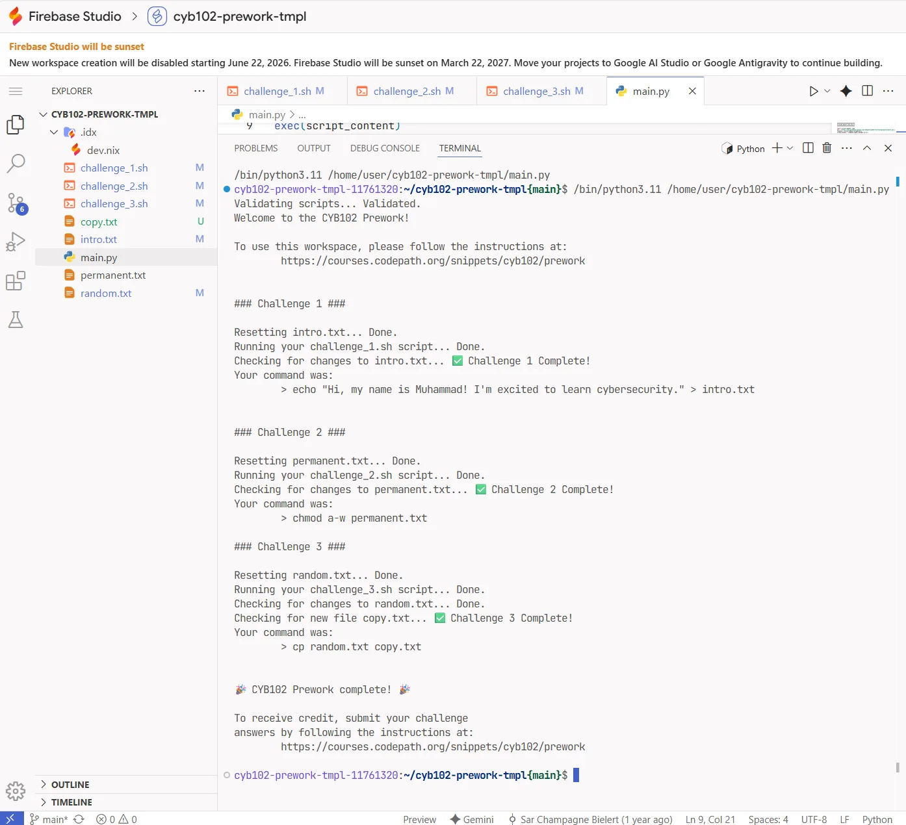

# Prework: Linux command-line warm-up

*CodePath CYB102 · Prework · Summer 2026*

Three shell challenges to get comfortable in a Linux terminal before the course: writing to a file, changing file permissions, and copying files. All three passed the automatic checks.

**Tools:** Linux shell, Bash, chmod

| Challenge | Task | Command |
|---|---|---|
| 1 | Write text into a file | `echo "..." > intro.txt` |
| 2 | Remove write permission for everyone | `chmod a-w permanent.txt` |
| 3 | Copy a file | `cp random.txt copy.txt` |

---

Part of [CodePath CYB102 Cybersecurity Labs](../README.md)
