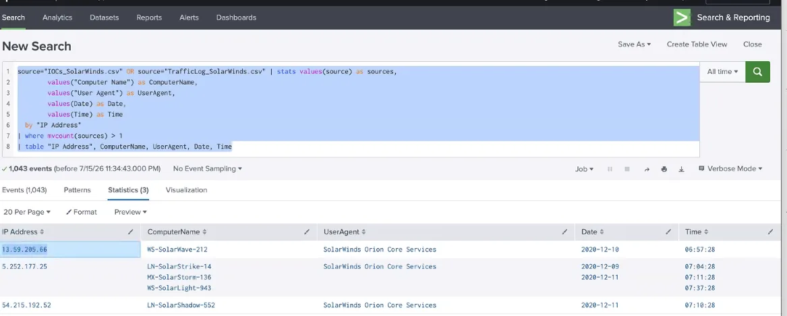
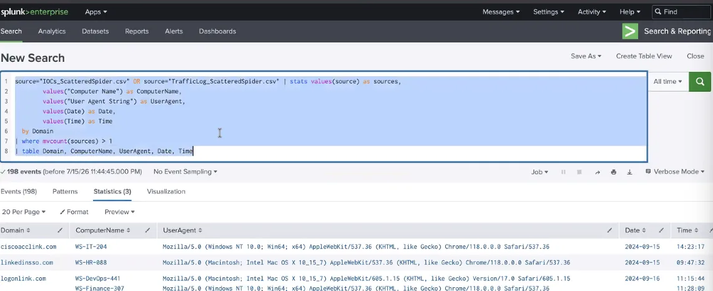
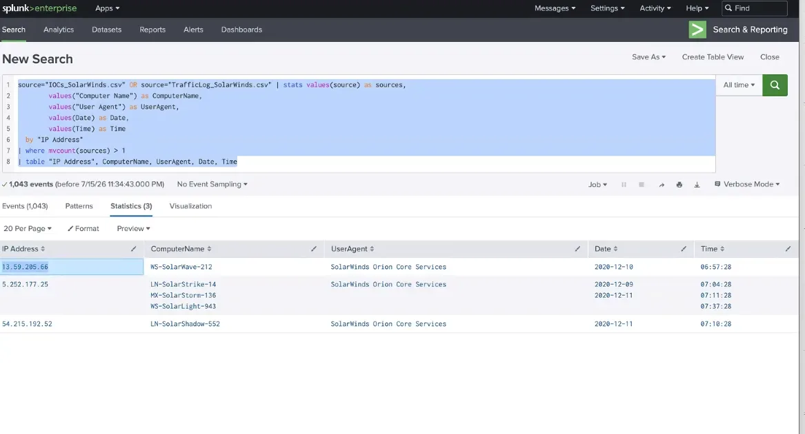
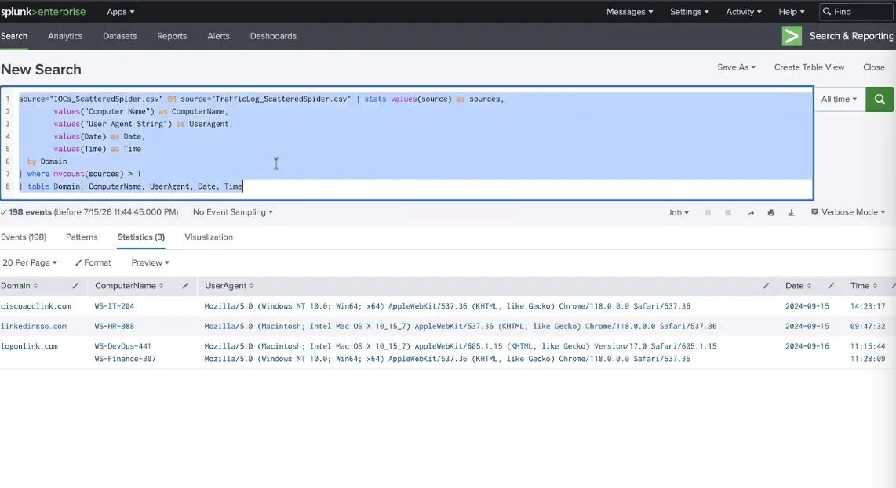

# Threat hunt: SolarWinds and Scattered Spider indicators in Splunk

*CodePath CYB102 · Threat hunting · Summer 2026*

Took published indicators of compromise from two real-world campaigns and hunted for them in a simulated company’s traffic logs, to find which machines talked to attacker infrastructure, when, and how widely.

**Files:** [`ioc-correlation.spl`](ioc-correlation.spl), the correlation search I used (swap the source names and group by Domain for the Scattered Spider hunt).

**Tools:** Splunk, SPL, VirusTotal, Threat intelligence, IOC hunting

## Results

| Result | What it means |
|---|---|
| **9** | machines found talking to attacker infrastructure |
| **6** | indicators matched across two campaigns |
| **2** | separate campaigns, four years apart |
| **1** | correlation search reused for both hunts |

## How I hunted

- Loaded each campaign’s IOC list and the company traffic log into Splunk as two sources.
- Wrote one SPL search that groups events by IP or domain and keeps only values seen in both sources (mvcount(sources) > 1), so only real matches survive.
- Tabled the computer name, user agent, date and time for every match to build a timeline.
- Checked each indicator’s reputation in VirusTotal to see how the infrastructure had aged.

## SolarWinds: matches in Splunk

*Every match carried the user agent “SolarWinds Orion Core Services”: attacker traffic disguised as normal Orion software.*

## SolarWinds findings (Dec 9 to 11, 2020)

| Indicator | Machines | When |
|---|---|---|
| 13.59.205.66 | WS-SolarWave-212 | Dec 10, 06:57 |
| 5.252.177.25 | LN-SolarStrike-14, MX-SolarStorm-136, WS-SolarLight-943 | Dec 9 to Dec 11 |
| 54.215.192.52 | LN-SolarShadow-552 | Dec 11, 07:10 |

## Scattered Spider: matches in Splunk

*Lookalike domains impersonating Cisco and LinkedIn, visited from IT, HR, DevOps and Finance workstations.*

## Scattered Spider findings (Sep 15 to 16, 2024)

| Indicator | Machines | When |
|---|---|---|
| ciscoacclink.com | WS-IT-204 | Sep 15, 14:23 |
| linkedinsso.com | WS-HR-888 | Sep 15, 09:47 |
| logonlink.com | WS-DevOps-441, WS-Finance-307 | Sep 16, 11:15 and 11:28 |

## The full searches

The same correlation search, run against each campaign. It keeps only indicators seen in both the IOC list and the traffic log.

## What it showed

- SolarWinds hid inside trusted software updates; Scattered Spider went after people with fake login domains. Two very different ways in.
- The SolarWinds IPs still carry a malicious reputation years later, while the phishing domains are newer and short-lived. Old indicators are still worth hunting.
- Two compromises years apart point to a monitoring gap: I’d recommend automatic IOC correlation alerts, domain-based detection and targeted phishing awareness for high-access teams.

---

Part of [CodePath CYB102 Cybersecurity Labs](../README.md) · Full write-up on my [portfolio](https://muhammadukhan.vercel.app/projects/threat-hunt-solarwinds-scattered-spider)
