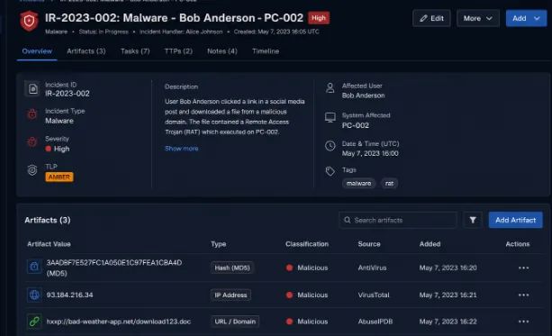

# Incident response: catching a mislabeled indicator

*CodePath CYB102 · Incident response · Summer 2026*

Worked a remote-access-trojan case in Cisco Catalyst, then verified every indicator in the analyst’s report against outside threat intelligence. One “high confidence malicious” IP turned out to be a harmless CDN address: a mistake that would have wasted analyst time and blocked legitimate traffic.

**Tools:** Cisco Catalyst, VirusTotal, AbuseIPDB, Incident response, IOC validation

## Results

| Result | What it means |
|---|---|
| **~45/60** | antivirus engines flagging the malware hash |
| **1/91** | vendors flagging the “malicious” IP |
| **1** | mislabeled indicator caught |
| **2** | controls recommended |

## The case in Catalyst

*Incident IR-2023-002 (training scenario): a user clicked a social-media link and ran a Word document that installed a remote access trojan.*

## Checking the report’s indicators

| Indicator | The report said | What I found | Verdict |
|---|---|---|---|
| MD5 3AADBF7E… | Remote access trojan | Flagged by ~45 of 60 engines; matches the Valyria/PoetRAT family: a Word macro dropper that runs a Python payload | CONFIRMED |
| 93.184.216.34 | High-confidence malicious | 0% abuse score on AbuseIPDB, 1 of 91 vendors on VirusTotal; a CDN address long used for example.com | MISLABELED |

## Gaps I found, and what I’d change

- **Unvetted indicators**
  - Problem: IOCs went into the report without a reputation check, so a harmless address was marked high-confidence malicious.
  - Fix: Validate every IOC automatically before it’s added to a case.
- **Macros allowed**
  - Problem: The chain was link → Word document → macro → Python RAT. Nothing stopped the macro from running.
  - Fix: Group Policy that blocks macros in Office files downloaded from the internet, breaking the chain at its first step.

## Most important phase

Containment. Even when detection is slow, containing the host quickly stops an attacker from spreading, escalating privileges or taking data.

---

Part of [CodePath CYB102 Cybersecurity Labs](../README.md) · Full write-up on my [portfolio](https://muhammadukhan.vercel.app/projects/incident-response-ioc-validation)
