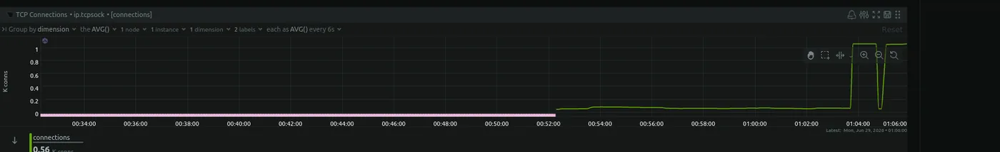
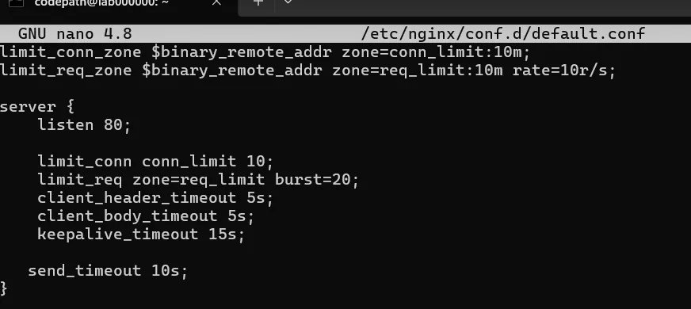
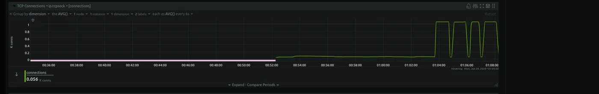

# Defending nginx against a Slowloris denial-of-service attack

*CodePath CYB102 · Network defense · Summer 2026*

Hit an unprotected nginx server with Slowloris and watched it lock up in Netdata, then hardened the config with connection limits, rate limiting and short timeouts, and ran the attack again. This time the server kept serving.

**Files:** [`nginx-hardening.conf`](nginx-hardening.conf), the hardening settings used in this lab.

**Tools:** nginx, Slowloris, Netdata, Linux, Rate limiting

## Results

| Result | What it means |
|---|---|
| **~560** | connections held open while unprotected |
| **10** | connections allowed per client after hardening |
| **10 r/s** | request rate limit (burst 20) |
| **5 s** | header and body timeouts |

## Before: unprotected

*Slowloris opened 500 connections; the graph climbed to about 560 and stayed there. Every worker slot was waiting on a request that would never finish.*

## The fix

*Per-client connection and request limits, plus short timeouts so half-open requests get dropped.*

## After: protected

*Same attack: short spikes that fall straight back down as nginx rejects and times out the extra connections.*

## What each rule does

- **Connection limits:** limit_conn_zone per client IP; limit_conn 10: one client can’t hog the server
- **Rate limiting:** limit_req at 10 requests per second; burst 20 absorbs normal spikes
- **Timeouts:** client_header_timeout 5s and client_body_timeout 5s; Slow, never-finished requests get dropped
- **Keep-alive:** keepalive_timeout 15s, send_timeout 10s; Idle connections free up quickly

---

Part of [CodePath CYB102 Cybersecurity Labs](../README.md) · Full write-up on my [portfolio](https://muhammadukhan.vercel.app/projects/slowloris-dos-mitigation)
